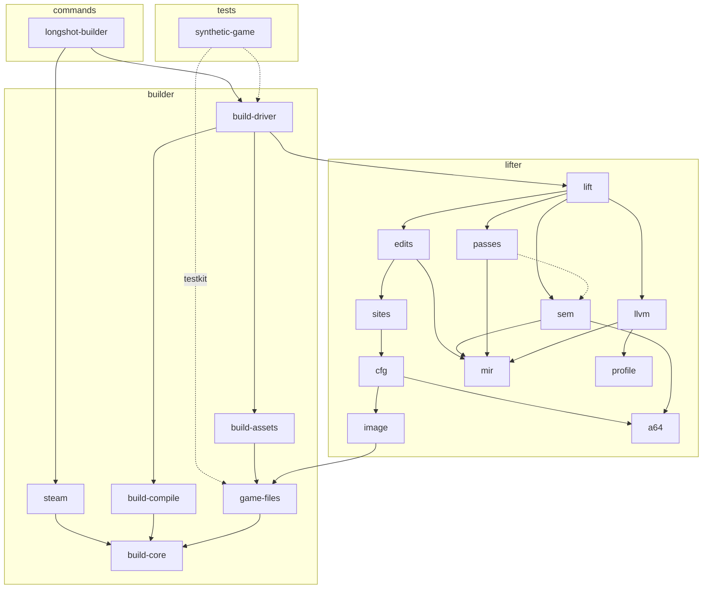

# builder/: the builder

Longshot's builder: `longshot-builder`, which turns a player's own dump into a game folder, and `longshot-builder dev`,
the lifter's own commands for developers. How it works is written in
[docs/dev/reference/builder.md](../docs/dev/reference/builder.md) (its crates in [the parts](../docs/dev/reference/builder.md#the-parts));
how to run it, its switches, its times and its errors in [docs/dev/reference/build.md](../docs/dev/reference/build.md);
what it tells a launcher in [docs/dev/reference/build-events.md](../docs/dev/reference/build-events.md).

```
cargo build --release -p longshot-builder   # target/release/longshot-builder (the workspace is the root's: Cargo.toml)
```

Its checks: [building and checking the builder](../docs/dev/reference/builder.md#building-and-checking-the-builder).

## The crates

Each has a README: what it does, its main parts, what it uses, the rules it keeps and its tests.

| Crate | What |
|---|---|
| [a64](crates/a64/README.md) | The decoder: an instruction word to a typed `Insn` |
| [image](crates/image/README.md) | The game's image: the modules laid out, patched, relocated and bound (`image.bin`, `image.json`), and read back as the lift reads it |
| [cfg](crates/cfg/README.md) | Discovery: the functions and their control flow, from the image alone, and the lift plan it gives |
| [sites](crates/sites/README.md) | The hook sites: the tables read, each site found once and placed |
| [edits](crates/edits/README.md) | Every change Longshot makes to the game's functions, as mid IR edits |
| [mir](crates/mir/README.md) | The mid IR: a function's blocks of typed SSA values over guest state |
| [sem](crates/sem/README.md) | Each instruction's semantics, from the Arm ARM, as mid IR |
| [passes](crates/passes/README.md) | Mid IR passes: shared page marks, the state simplified, big functions split |
| [llvm](crates/llvm/README.md) | The LLVM IR writer |
| [profile](crates/profile/README.md) | The guest profile, keyed by the guest code |
| [lift](crates/lift/README.md) | The function builder, and the whole lift to gen/ with its cache |
| [game-files](crates/game-files/README.md) | The read stage: the .nup, the romfs index, the code modules, the checks, the mods' ExeFS patches |
| [build-core](crates/build-core/README.md) | What every stage shares: the events, errors, jobs, the memory gate, files, keys, the lock |
| [build-compile](crates/build-compile/README.md) | The compile: units, keys, the object store, the scheduler, the links |
| [build-assets](crates/build-assets/README.md) | The finish's assets: texts, button prompts, shader list, pipeline lists, icons |
| [build-driver](crates/build-driver/README.md) | The driver: the stages in order, the work folder, the stores, the game folder |
| [steam](crates/steam/README.md) | Longshot as a non-Steam game in Steam's library: `shortcuts.vdf`, the tile's id and art |
| [longshot-builder](crates/longshot-builder/README.md) | The command the launcher runs, and `dev`: the lifter's own commands, for developers |
| [synthetic-game](crates/synthetic-game/README.md) | The builder end to end on a synthetic game |
| [rt](rt/README.md) | The runtime (C) the lifted code and the host share |

How they depend on each other, from the Cargo.toml files: an arrow goes from a crate to one it uses. An edge that a
longer path already gives is left out (each README lists every direct dependency); the dashed edges are a test's.



Nothing in `builder/` holds or is made from the game.
