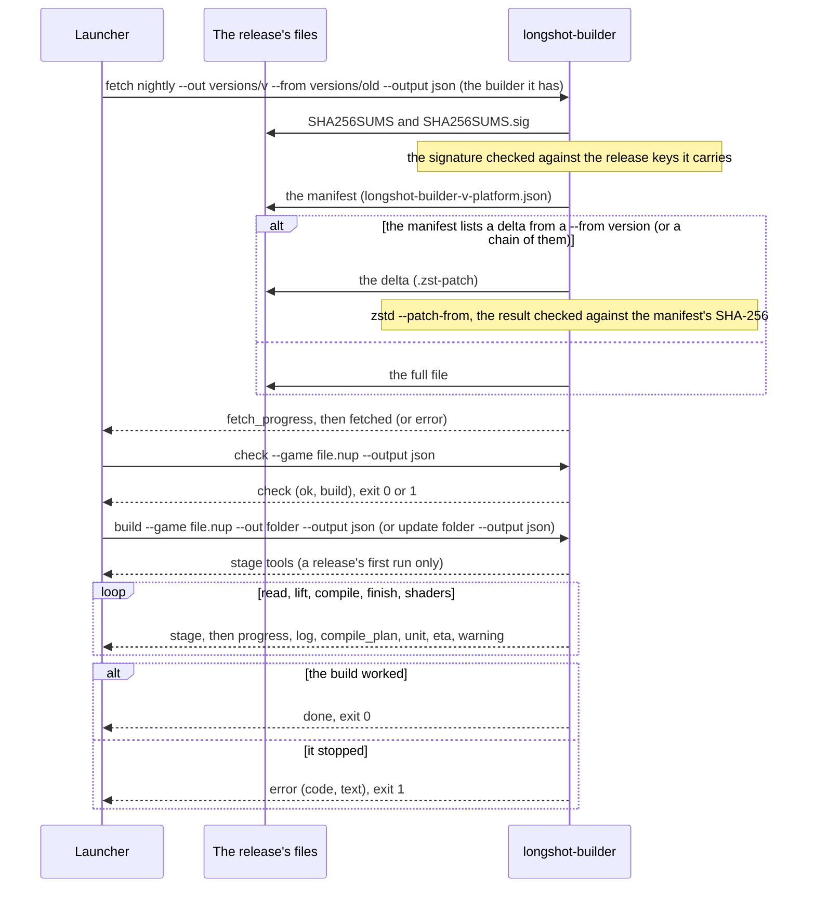

# longshot-builder's events

What `longshot-builder` ([the builder](builder.md), [how to run it](build.md)) tells a launcher.
With `--output json`, stdout carries these events and nothing else: one JSON object a line (JSON Lines), UTF-8, each line
written whole and flushed at once. stderr is free text for a person and carries nothing a launcher must read. Without
`--output json`, the same events are written as text (progress at most once a percent); that form is for people and may
change.

Every event has `"v"` (the format's version, now `1`) and `"type"`. A reader takes the events of the versions it
knows and ignores a field it does not know; a change an older reader would misread raises `v`.

## How a launcher runs it

The Longshot Launcher installs a release's `longshot-builder` by asking the one it has to `fetch` it
([releases](releases.md)), checks the player's game with `check`, then runs `build` (or `update`) and reads the events
until the last one:



A command line it does not take (an argument that is not valid Unicode among them) is exit status 2, said on stderr, and with `--output json` as an `error` event too (`usage`).

## The events

| `type` | Fields | When |
|---|---|---|
| `stage` | `stage`, `text` | A step begins. `text` is the builder's sentence for it. |
| `progress` | `stage`, `fraction` (0 to 1, the step's own), `overall` (0 to 1, the whole build's) | As a step goes. |
| `compile_plan` | `changed`, `total` | Once the compile knows how many units it compiles of all of them (the others come from the store). |
| `unit` | `name`, `seconds`, `result`: `compiled`, `cached`, `retried` (compiled again alone after failing among others) or `failed` | A unit of the compile done. |
| `eta` | `seconds` | The compile's time left, from what earlier builds took on this PC. |
| `log` | `text` | A line of the build's log ("details"). |
| `warning` | `code`, `text` | Something the player may want to know or fix, that does not stop the build. |
| `check` | `ok`, `build` (main's build id, short), `text` | `longshot-builder check`'s answer. |
| `stamps` | `stamps`: `{"compiler": ..., "translator": ...}` (the SHA-256 of tools.lock's compiler, sysroot and `cpm` lines; the shader translator's stamp, the renderer's `LONGSHOT_SHADER_STAMP`) | `longshot-builder stamps`'s answer: what a launcher keys a game folder's shader caches by (two builders with the same two keep each other's). A build writes both into `longshot_version.txt` (`compiler_stamp=`, `translator_stamp=`). |
| `shared` | `zip` (its path), `pipelines` (how many it holds), `issue` (the issue's link to attach it to), `template` (the filled text to paste there) | `longshot-builder share`'s answer: the pipeline list zipped. |
| `perf_report` | `tick`, `keep_sent`, `waiting`, `kept` (copies in `perf_sent/`), `sent`, `refused` (this run's), `version`, `release`, `relay` (where summaries go, `""`: nowhere), `busy_until` (Unix seconds, or `null`) | `longshot-builder perf-report <game folder> [--send \| --tick on\|off [--keep-sent on\|off]]`'s answer: the performance statistics' state after it read, sent or ticked them ([profiling](profiling.md#performance-statistics)). Exit status 0 whatever the relay said: what it could not take stays in `perf_pending/`. |
| `storage` | `cache` (its folder), `budget`, `total` (bytes, after the prune), `kinds`: each `{"kind", "bytes", "entries"}`, `kind` one of `objects`, `lifts`, `shaders`, `runtimes`, `tools`, `sources`, `work`, `mods`; `removed` (entries let go, 0 without `--prune`), `freed` (bytes) | `longshot-builder storage [--prune]`'s answer ([the cache's budget](build.md#the-caches-budget)). |
| `verify` | `ok`, `checked` (the builder's files checked), `missing`, `changed`, `unchecked` (noted by an older builder without a SHA-256), `extra` (neither the builder's nor the game's data: left as they are), `excluded` (the game's and the player's data there; a folder's name ends in `/`), `repaired` (`--repair`'s, from the work folder or by an update): each a list of names in the game folder | `longshot-builder verify --out <folder> [--repair]`'s answer, after a warning for each damaged file ([verify](build.md#verify-a-game-folder)). Exit status 0 when `ok`. |
| `steam_shortcut` | `action` (`added`, `updated`, `unchanged`, `removed`, or `absent`: `--remove` and no tile of its own), `name`, `app_id` (Steam's id, unsigned), `library` (the `shortcuts.vdf` written), `command` (the program and its launch options), `artwork` (pictures written now), `steam_running` | `longshot-builder steam-shortcut`'s answer ([Steam](build.md#steam)). |
| `doctor` | `ok` (no check failed), `checks`: each `{"id", "status", "text", "fix"}`, `status` one of `ok`, `warn`, `fail`, `unknown` (it couldn't tell), `fix` the player's fix (`""` when none); `id` one of `vulkan`, `gpu`, `driver`, `disk_space`, `game_copy`, `folders`, `long_paths` and `defender` (Windows), `game_running` | `longshot-builder doctor`'s answer ([doctor](build.md#doctor)). Exit status 0 when `ok`. |
| `crash` | `record` (the crash or unclean record's path, `null` for a start that failed with none), `log` (the run's log, or `null`), `text` (what happened and why, for the player) | `longshot-builder play`: the game it started crashed, ended uncleanly or could not start, or a record of an earlier run nobody showed, at play's start ([crash window](crash-window.md)). A normal exit (0) and a quit have none. The builder sends nothing for it (`send=1` in longshot_crash.ini aside). |
| `build_report` | `report` (the report's JSON text, exactly as Send would post it), `address` (Longshot-api's telemetry/build) | `longshot-builder play`: the build failed; a launcher may show the report to the player and send it itself. The builder sends nothing for it (`--send-build-statistics`, the player's yes a launcher passes to `play`, `build` and `update`, sends every build's end on its own with no log). |
| `from_source` | `folder` (the version folder), `program` (its `Longshot.x86_64` or `Longshot.exe`), `commit` (40 hex), `version` (the name it carries), `signed` (always `false`), `downloaded` (bytes this run downloaded) | `longshot-builder from-source`'s answer, just before its `done` ([a builder from source](build.md#a-builder-from-source)). |
| `fetch_progress` | `step` (`list`, `manifest`, `delta`, `patch`, `check`, `full`, `place`), `hop` and `hops` (the delta of a chain, from 1; 0 and 0 for the full file), `bytes` and `total` (the step's downloads; `total` 0 when not a download) | `longshot-builder fetch` (and `self-update`) as it goes ([fetch](build.md#fetch-a-version)). |
| `fetched` | `version`, `channel`, `platform`, `program` (its path), `how` (`present`, `delta`, `chain`, `full`), `from` (the version a delta or chain started from, or `null`), `through` (the releases a chain passed, oldest first), `downloaded` (bytes), `sha256` and `size` (the released full file's), `stamps` (the manifest's `compiler` and `translator`) | `longshot-builder fetch`'s answer: the program in place. |
| `self_update` | `action` (`updated`, `up_to_date`, `declined`, `not_asked`, `not_a_release`), `version` (this program's), `channel`, `to` (the newer version, or `null`) | `longshot-builder self-update`'s answer ([self-update](build.md#self-update)). |
| `info` | `version`, `program`, `platform`, `capabilities`, `profile`, `build`, `features`, `game`, `upscalers` | `longshot-builder info`'s answer ([info](build.md#info)). |
| `error` | `code`, `text` | The build stopped. The last event of a failed run. |
| `done` | `folder`, `seconds`, `compile_seconds`, `previous_seconds` (the last build's in this work folder, or `null`) | The build is done. The last event of a build that worked. |

`stage` is one of `tools`, `read`, `lift`, `compile`, `finish`, `shaders`; `from-source` has steps of its own,
`source`, `rust`, `source_tools`, `crates`, `pack`, `builder`, in that order, whose `overall` is that run's own bar
(source to 0.02, rust to 0.08, source_tools to 0.12, crates to 0.15, pack to 0.35, builder to 1: a first run's usual
shares). `tools` comes first, and only on a
release's first run (any command but `sources`): the tools and sources the program carries unpacked into the
per-user cache, seconds on an SSD and a minute or so on a hard drive, with no `progress`; its `overall` is 0.
`overall` places a step's progress in the whole
build by its usual share of the time (read 0 to 0.15, lift to 0.26, compile to 0.87, finish to 1), so one bar can show
it; `shaders`, the built game preparing its shaders after the build's times, keeps `overall` at 1 and has its own
`fraction`. A first build may start that preparation beside the compile; its events still come only after
the `shaders` `stage` event, never among another step's: what it said before then comes at once (its log lines in order,
then its latest `progress`), and the rest as it goes until it ends.

```json
{"v":1,"type":"stage","stage":"compile","text":"Compiling the game"}
{"v":1,"type":"progress","stage":"compile","fraction":0.5,"overall":0.565}
{"v":1,"type":"compile_plan","changed":12,"total":148}
{"v":1,"type":"unit","name":"lifted_7101a2c0.ll","seconds":41.2,"result":"compiled"}
{"v":1,"type":"warning","code":"slow_disk","text":"..."}
{"v":1,"type":"shared","zip":"/home/p/Downloads/longshot-pipelines-2026-11-23.zip","pipelines":555,"issue":"https://...","template":"..."}
{"v":1,"type":"error","code":"disk_full","text":"..."}
{"v":1,"type":"done","folder":"/home/p/Games/Longshot","seconds":812.0,"compile_seconds":530.4,"previous_seconds":null}
```

## Codes

A `code` is stable: a launcher may show its own words for it, and `text` is the builder's sentence for the player.
The builder's own failures (not the player's to fix) ask for the build log (`build.log` in the work folder). Every
code the builder can say is in this table, and only those (`build-driver/tests/codes.rs` checks it both ways).

| Where | Codes |
|---|---|
| The builder's own failures | `io`, `tool_failed`, `bad_data`, `internal_error` (the builder stopped on a bug of its own: the text names the log) |
| The command line, the tools | `usage` (exit status 2), `bad_jobs`, `bad_language`, `bad_upscaler`, `bad_compile_shaders`, `tools_incomplete`, `stage_not_ready` |
| The game files | `game_not_found`, `game_folder_incomplete`, `no_game_files`, `no_romfs`, `nup_missing`, `not_a_nup`, `nup_incomplete`, `nup_unreadable`, `nup_locked`, `nup_drive_error`, `nup_unsafe_path`, `nup_path_not_unicode`, `nup_path_too_long` (more than the 1023 bytes the game takes), `nup_damaged` (its files laid out in a way the game refuses: data past its end, or files sharing data but not its size), `no_such_title`, `nup_moved`, `not_the_same_nup` (`index` given another .nup than the folder's, to point it at), `not_a_module`, `unsupported_build`, `romfs_incomplete`, `dump_damaged`, `dump_has_links`, `dump_unreadable`, `extraction_link` |
| The folders | `work_folder_busy`, `game_folder_busy` (another build is writing the same game folder), `game_folder_not_writable`, `game_folder_overlaps`, `game_files_overlap` (the game or work folder is the game files' or inside them, or they are inside it), `romfs_folder_theirs` (a build from a dump into a game folder with a `romfs` folder of the player's own, which it would write over), `not_built_here` (an update of a folder this builder did not build), `profile_in_use` (play: another start holds the profile, its game running or being built; exit status 123: [one copy per profile](build.md#one-copy-per-profile)), `profile_unwritable` (play: a folder of the profile the game writes in, such as `saves/save` or `mods/`, can't be made or written: the folder and why; exit status 121), `profile_unreadable` (a profile's `profile.json` it can't read, of a newer format, or naming no copy where `--profile` needs one: [play](build.md#play-the-version-folder-and-the-profile)), `stage_failed`, `game_running`, `disk_full`, `drive_error` |
| The upscalers' vendor files | `license_not_accepted` (a vendor's license not accepted for its files' pin: an update asks again after the builder moves to a new pin), `bad_license`, `download_failed` |
| The lift and the compile | `image_missing`, `lift_missing`, `compiler_missing`, `rust_missing` (the tree's Rust, longshot-rs, has no prebuilt library of its sources and nothing to build it with: no cargo, or a tree without builder/), `cpu_unknown`, `compile_failed`, `link_failed`, `renderer_link_failed`, `ffmpeg_missing`, `vulkan_headers_missing`, `dlss_sdk_missing` |
| `share` | `pipelines_not_shared` |
| `from-source` | `source_download_failed` (the commit's archive could not be downloaded), `source_unreadable` (an archive that is not a git archive of the commit asked for, holds a link or a path outside its folder, is too large, or pins its Rust or tools unreadably), `no_builder_in_source` (a commit older than longshot-builder), `toolchain_download_failed` (a part of the source's Rust not downloaded, or not the SHA-256 it pins), `crates_download_failed` (`cargo fetch` of its Cargo.lock failed), `tools_download_failed` (a tool of its tools.lock not downloaded or unpacked), `builder_compile_failed` (its longshot-builder or RenHDrum did not compile: the text ends with what cargo said), `pack_failed` (its third-party objects did not compile, or its builder does not read the pack made for it), `work_folder_busy` (another `from-source` uses the same cache) |
| `fetch`, `self-update` | `release_unreachable` (the forge did not answer, or no curl), `no_such_release`, `no_release_on_channel`, `release_refused` (its `SHA256SUMS` not signed by a key the builder trusts, or a file not the one it names), `no_builder_in_release` (no `longshot-builder` manifest for the platform: a make_game.py release), `download_failed` (the full file, after any delta failed), `cancelled`, `fetch_failed` (a file of the version folder that could not be written), `self_update_failed` (the new version does not run here, or could not take the program's place) |
| `mod` | `mod_tooling_missing` (this builder has no mod tooling: the Mod API's crate is not built in; exit status 125) |
| `steam-shortcut` | `steam_not_found` (no Steam library for this user), `steam_library_unreadable` (a `shortcuts.vdf` that doesn't read whole, or a link that can't be followed: left as it is), `steam_name_taken` (a tile of that name it did not make), `steam_still_running` (`--quit-steam`, and Steam didn't quit) |
| Warnings | `slow_disk`, `low_disk_space`, `asset_not_made` (the game shows its own text, prompts or shaders without it), `shaders_not_prepared` (the game prepares them at its first start), `translation_damaged` (a lifted unit's text came out different when made again, so the PC changed it; compiled again), `upscaler_dropped` (an update leaves out an upscaler whose license is not accepted for its files: none in the profile, a vendor's new pin, an update for no profile without `--accept-licenses`), `romfs_copied`, `romfs_folder_kept` (a `romfs` folder the builder did not make is in a game folder built from a .nup: the game reads it first), `no_npdm`, `prompts_ring`, `prompts_hint`, `prompt_picture_missing`, `prompt_picture_size`, `prompts_textures` (a texture the prompts draw on is not the size or format the builder knows: the game keeps its own icons), `game_file_missing`, `game_file_changed` (`verify`: a file the build put in the game folder is gone, or not its bytes), `game_files_unchecked` (`verify`: files an older builder noted without a SHA-256), `steam_running` (`steam-shortcut`: Steam runs, and shows the change once it starts again), `renhdrum_not_built` (`from-source`: no archiver on this PC for RenHDrum's C; the running builder's library goes in, or none), `mod_needs_import` (a mod in the profile's `mods/` is in an emulator's layout, bare `romfs`, `exefs` or `cheats` with no `mod.json`: left out until `Longshot.exe mod import` makes it a Longshot mod; said by a build or an update of a profile, and by play at each start, [mods](mods.md#one-mod-format)), `confirm_declined` (a question for the player, such as trusting a mod's code, could not be asked: no window with this `--output`, or none could open; it was declined) |

## Exit status

0: done (`check`: the supported build). 1: stopped, said by the `error` event (`check`: another build, said by the
`check` event; `prepare`: the shaders were not prepared, said by the `shaders_not_prepared` warning; `verify`: the game
folder is not as the build put it, said by the `verify` event). 2: a command
line it does not take, said on stderr (and with `--output json` as a `usage` error event).

Playing (`longshot-builder play`, or the program players start in a version folder:
[play](build.md#play-the-version-folder-and-the-profile)) writes no event of its own but `profile_in_use` and the
`mod_needs_import` warning: its exit status
is the game's, or 120 (not set up: the profile names no copy, none given or chosen), 121 (the build, the update or the
game's start failed, said in a message box and in the game folder's `logs/longshot_update.log`) or 123 (another start
is playing the same profile, its game running or being built: with `--output json` or `recomplauncher` an `error`
event, `profile_in_use`, says so; [one copy per profile](build.md#one-copy-per-profile)). A profile folder the game
could not write in is 121 too, with the `profile_unwritable` error event. A game that asks to be built again says so
over [its channel](build.md#the-games-channel-to-its-builder) and exits 0: no exit code stands for it.

`longshot-builder mod` without the Mod API's tools writes the `mod_tooling_missing` error and exits with 125.
