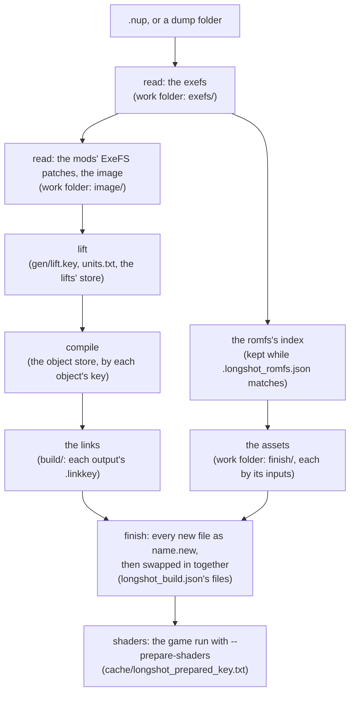
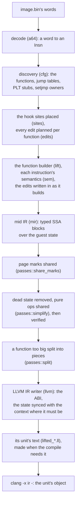
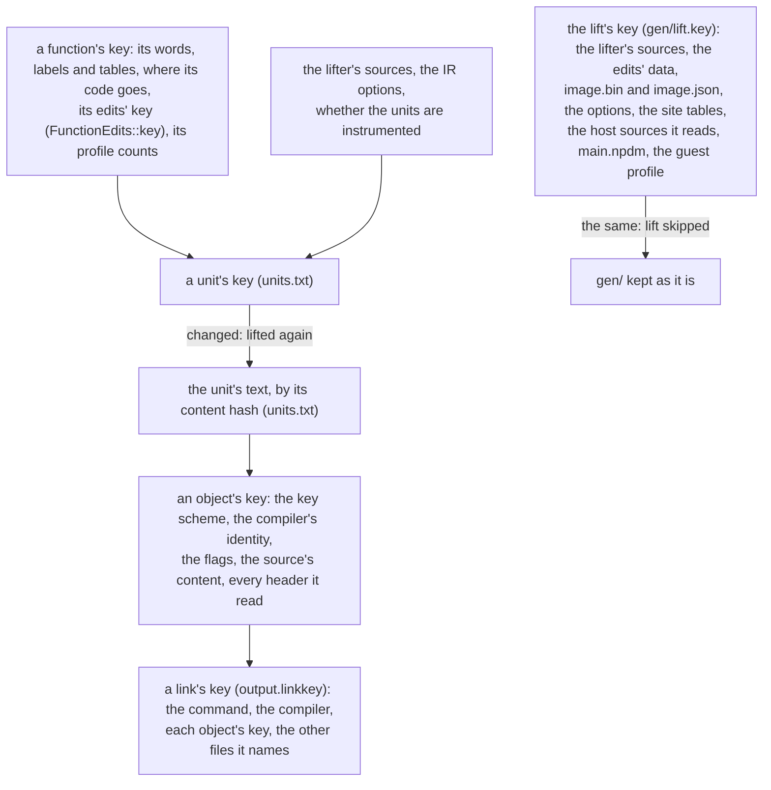

# The builder

How `longshot-builder` turns a player's own dump into a game folder: its parts, the lift and its mid IR, the units, the
gen/ folder, the runtime, the guest profile and the caches. How to run it, its switches, its times and its errors are in
[the build](build.md); what a launcher reads from it is in [its events](build-events.md).

The builder is one Rust workspace, [`builder/`](../../../builder), and one command, `longshot-builder`. A release ships it as
one self-contained file per platform, which carries everything it builds with ([below](#what-a-release-carries)).
Players build through the Longshot Launcher, which runs `longshot-builder build --output json`; no player needs Python. It reads the .nup, lays out the game's image, lifts every guest function to LLVM IR through a typed SSA
mid IR (where its analyses and the [hook sites](hooks.md) live), compiles that IR and the host with the pinned clang,
and writes the game folder and its assets.

## The parts

| Crate | What |
|---|---|
| `crates/a64` | The decoder: an instruction word to a typed `Insn`; `Insn::flow()` for discovery |
| `crates/image` | The image: built from the code modules (laid out where Eden loads them, patched, relocated and bound) as `image.bin` and `image.json`, and read back as the lift lays it out |
| `crates/cfg` | Discovery: the functions and their control flow, and the plan it gives (`cfg::plan`: the functions, tables, stubs) |
| `crates/sites` | The [hook sites](hooks.md): the tables read, the signatures resolved, each site placed |
| `crates/edits` | Every change Longshot makes to the game's functions as mid IR edits, in Rust data: each site's form, the supported build's patches (the output size, the gameplay HUD's wrapper), the host's entry hooks of the SDK's functions; per function, with a content key |
| `crates/mir` | The mid IR: a function's blocks of typed SSA values over the guest state's locations, a verifier, a text dump |
| `crates/sem` | Each instruction's semantics, from the Arm ARM, as mid IR: every integer, memory, atomic, system, floating-point and Advanced SIMD form the game uses |
| `crates/lift` | The function builder: one discovered function as mid IR (blocks, transfers, tail calls, jump tables, setjmp calls, traps), its edits written in as it is built; and `whole`, the whole lift ([below](#the-whole-lift)) |
| `crates/passes` | Mid IR passes: page marks shared (`marks.rs`), the guest state's dead reads and writes removed and repeated pure ops shared (`simplify.rs`) |
| `crates/llvm` | The LLVM IR writer: the lifted code's ABI, the state synced with the context only where it must be (`sync.rs`) |
| `crates/profile` | The [guest profile](#the-guest-profile) |
| `crates/launcher-profile` | A player's profile folder: `profile.json` read and written, every key it does not know kept, and the folder's paths ([profiles](profiles.md)); play reads and writes the file through it alone, and the game may link it (serde and serde_json only) |
| `crates/game-files` | The read stage: the .nup (listed, verified, its exefs unpacked, its romfs indexed for the game to read in place: `longshot_romfs.idx`, format in `src/romfs.rs`), the code modules (LZ4 and ZBIC, `src/zstd.rs`), the dump's checks, the mods' ExeFS patches, the game's title, the disk |
| `crates/build-core` | What every stage shares: errors with their codes, the events (`report.rs`), the worker count (`jobs.rs`), the memory gate (`memory.rs`), the work folder's lock, keys, file writes by rename |
| `crates/build-compile` | The compile: every unit and its flags, keys by content, the object store, the scheduler under the memory gate, the links ([below](#the-compile)) |
| `crates/build-assets` | The finish's assets, from the romfs (the index or a folder): the texts reworded for a PC, the button prompts (the icon font, the textures in ASTC and BC4, the ring and hint places), the shader list, the shipped pipeline lists, the window's icon and the exe's name, the pipeline list's zip for `share`; each output cached by exactly its inputs |
| `crates/build-driver` | The driver: the stages in order with their caches, the work folder and the stores, the game folder's files ([below](#a-build)) |
| `crates/steam` | Longshot as a non-Steam game in Steam's library (`longshot-builder steam-shortcut`, [Steam](build.md#steam)): the binary `shortcuts.vdf`, Steam's id rule, the signed-in account's library, the tile's art; the Longshot Launcher's, ported |
| `crates/release` | Longshot's releases as a builder installs them (`fetch`, `self-update`: [fetch](build.md#fetch-a-version)): the forge's list through Cloudflare's edge, the signed `SHA256SUMS` (ECDSA P-256, `scripts/release_keys.json`), the manifest, a delta or a chain of up to 5 applied by ruzstd, the program swapped in while it runs; the Longshot Launcher's, ported |
| `crates/longshot-builder` | The command the launcher runs; a release's carries the pack, appended to the program after the link (`dev release attach`). `longshot-builder dev`, the developers' commands: the lifter's own (`lift`, `discover`, `sites`, `profile`, `site-hooks`, `words`, `decode`), `tools` (`tools.lock`) and `release` (a release's packaging) |
| `crates/synthetic-game` | The builder end to end on a synthetic game: a small AArch64 program of its own (`game/main.S`) packed as a .nup, built through every stage, run with a test host, and built again after a one-instruction change ([below](#building-and-checking-the-builder)) |
| `rt/` | The runtime the lifted code and the host share (`a64.h`, `a64_rt.c`, `a64_fp.c`), written into gen/rt/ by the lift ([below](#the-runtime)) |

The dependencies are few and pinned by checksum in `Cargo.lock`: serde, serde_json, thiserror, toml, sha1_smol, sha2,
miniz_oxide, ruzstd, lz4_flex, libc and windows-sys, and for build-assets' fonts, pictures and xz the pure-Rust
ab_glyph_rasterizer, ttf-parser, png, zune-jpeg, flate2, crc32fast and lzma-rs, and for the release key's signature
RustCrypto's p256 (with its ecdsa, elliptic-curve and their own few). A new one is named in its pull request.

## A build

The stages, and what each keeps for the next build. The romfs's index and the assets are made on a thread of their
own beside the image, the lift and the compile; nothing reaches the game folder before the finish's swap:



`build_driver::build::build`, in order:

1. **Before anything is read**: the work folder held (`longshot-builder.lock`: one build at a time, `work_folder_busy`
   otherwise) and the game folder too (`.longshot-builder.lock` in it, `game_folder_busy`: two work folders building
   into one game folder), the PC kept awake, the game folder apart from the work folder, the stores and the tools
   (`game_folder_overlaps`) and writable, warnings for a hard drive (`slow_disk`) or little room (`low_disk_space`).
2. **Read** (`read`): the exefs from the .nup (game-files), the mods' ExeFS patches (`mods.json`'s order, clashes with
   hook sites refused), the image (`image::build`). Once the exefs is read, the romfs's index is written on a thread of
   its own, beside the patches, the image, the lift and the compile: it reads the .nup, they compute. Then, on that
   thread, the assets (texts, prompts, shader list, pipeline lists, icon), into the work folder's `finish/`. The
   romfs's index, its note and the damaged files' list are written there too, and so are the game's name and icon:
   nothing of the game folder changes before the finish (but a dump's `romfs/`, linked into it: its 26 GB is not
   staged).
3. **Lift** (`lift`, `lift::whole`): unchanged units kept by their keys, a whole lift taken from the lifts' store by
   its key. The units' texts are not written ([below](#the-units-texts)).
4. **Compile** (`compile`, `build_compile`): every object by its key from the object store, the rest compiled (a lifted
   unit's text made as its compile starts, given to clang on its standard input), then the two links. A failure leaves
   the next build what it needs not to fail the same way: the renderer's objects dropped after its link failed, the
   lift's key dropped after a lifted unit did not compile (its text is made again), the game's objects and the lift's
   key dropped after the game's link failed on them (an undefined symbol, an object it can't read:
   `build::objects_at_fault`); a link that failed otherwise (the linker killed, a full disk) keeps everything and the
   next build links again. A tree source that did not compile keeps everything: a typo in `host/` costs no lift.
5. **Finish** (`finish`): the new files (the game, the renderer, their libraries, the vendors' files, the assets from
   `finish/`) copied in as `<name>.new`, then swapped in together: each old file moved aside as `<name>.old`, the new
   one renamed in, and on the first that fails (a running game's file on Windows: `game_running`) every step undone, so
   the folder holds the old build or the new one. The builder's own files it no longer makes (an upscaler not asked
   for any more, a language not reworded) are taken out in the same swap. Once the swap is in, what the builder put
   there that this build has none of goes: a damaged files' list, a dump's build's index (and, for a .nup's build, the
   dump's `romfs/`), and what old builders left (`bin/`'s game files, `.longshot_exefs/`, `.longshot_romfs*` but the
   index's note). A `romfs/` goes only when it is the builder's: the installed note names it (`romfs/`, written when a
   build linked it), or every file in it is a hard link of the dump the folder's record names. The game reads a
   `romfs/` before the .nup's index (`host/hos_main.c`), so a stale dump's folder would win; one of the player's own
   stays, said (`romfs_folder_kept`). A build from a dump refuses a game folder whose non-empty `romfs/` is not the
   builder's (`romfs_folder_theirs`): its links would write over the player's files. `longshot-builder index` does
   only the index's own removals (the damaged list, the dump's `romfs/`): it installs no game, so an old builder's
   game in `bin/` stays until a build replaces it. A file still as the last finish put it, with
   the same bytes, is not copied again (the record's `files`, in `longshot_build.json`). An asset that could not be made is an
   `asset_not_made` warning (the game does without). Then the seed pipeline list, `language.txt`, `longshot_version.txt`, `exefs_patches.txt` and `longshot_build.json`,
   what `update` builds the folder again from. The object store's clean-up, the times (`build_times.json`).
6. **Shaders** (`shaders`): the built game run with `--prepare-shaders` (`build_driver::shaders`), in the game's own
   environment. It never fails a build: a PC whose Vulkan can't, a run silent for 15 minutes, `--no-prepare-shaders`,
   `LONGSHOT_NO_PREPARE`, or a Windows game built on Linux leave the work to the game's first start
   (`shaders_not_prepared`). The build's times are taken before this step, so they stay comparable.
   It runs only when its key changed (`cache/longshot_prepared_key.txt`, written when a preparation gets to its end): the
   SHA-1s of the renderer (`longshot_vk.so`, a Windows game's `longshot_vk.dll`), `longshot_shaders.bin` and
   `longshot_pipeline_states_shipped.bin` (taken again only for
   a file whose size or write time moved), the Compile shaders level, and the drivers, read with no Vulkan call. On
   Linux: each Vulkan driver manifest and its library's size and time, NVIDIA's version, the GPUs' vendor and device,
   the shader store's switch (`LONGSHOT_SHADER_STORE`; not where the drivers keep their caches: a key of what made
   them, not of their place). On Windows, from the registry: the loader's driver list and each display
   adapter's driver (name, device, `DriverVersion`, the manifests its `VulkanDriverName` names), each manifest with its
   library's size and time, whether NVIDIA's and AMD's shader cache folders are there, `LONGSHOT_SHADER_STORE`. A
   change to the game's code alone keeps it; so does a driver cache emptied by hand, which the game's first start
   finds and builds again itself.
   When the game folder's caches are made from nothing (a first build, or its caches deleted; Linux), the
   preparation starts beside the compile instead (`shaders::Early`): the renderer's units and the preparation's
   driver's go first, both are linked as soon as they are compiled, and once the finish's assets are made the driver
   runs in `<work>/prepare/` (the assets, the renderer and the fetched files linked in) once the build's memory gate,
   the compile's own, has room for it (9.5 GB, at most `LONGSHOT_MEM_LIMIT_GB`) beside the compilers running, or no
   compiler is in it: one limit holds both, and the compile keeps its floor while the preparation runs. The driver is the game's executable without the lifted game (`build_compile::link_prepare`: the
   host, the game's Rust and the lift's runtime, the lifted game's few symbols the host names stood in for), named `longshot` as the
   game is, since NVIDIA's driver files its shader cache by the program's name; `--prepare-shaders` returns before the
   image and the OS layer, so it runs the game's own code for this. Its lines wait until this step, so its progress
   never shows as the compile's; from the step on they are said as they come while the build waits for its end
   ([events](build-events.md)). A game folder built for a profile keeps its caches in the shared shader cache folder
   ([where things are](build.md#where-things-are)): the early preparation writes there itself, and nothing moves.
   Otherwise its `cache/` is moved into the game folder's at this step, each entry put beside its
   place first (renamed, or copied when the work folder is on another drive) and only then swapped for the old one;
   one that can't be moved leaves the preparation to run in the game folder now, as without it. A build that stops
   before this step (an error in the compile or the finish) stops the preparation with it: its game killed, its
   staging folder removed. `LONGSHOT_PREPARE_EARLY=0`: after the finish, as before.

A build stopped in the swap itself (the PC lost power: the swap takes milliseconds) can leave some files of each
build, a `<name>.old` whose `<name>` is missing, or a `<name>.new` never swapped in. The next build's finish first
puts each such `.old` back where its file is missing, removes the other `.old` and `.new` files (on Windows one a
running game holds stays until a build finds it free: Windows removes a file at the PC's restart only for an
administrator) and copies in every file whose bytes are not the new build's, so it
leaves the folder whole.

`longshot-builder update <game folder>` is the same build from the folder's `longshot_build.json`: its game, its
upscalers; its language is kept (the mods: the profile's, given again by play or `update --profile`). The program players start runs it for a profile
when its fast check says the folder is out of date ([play](build.md#play-the-version-folder-and-the-profile)). A folder this builder did not build is refused (`not_built_here`).

### The game folder

| File | What |
|---|---|
| `longshot` / `longshot.exe` | The game (a folder built by the old Windows Builder had it in `bin/`, which `host/hos_paths.h` still reads) |
| `longshot_vk.so` / `longshot_vk.dll` | The renderer, beside the game |
| `longshot_nvngx.dll_nr.dll` | Windows, a build with NVIDIA's NGX SDK: DLSS 5's forwarder beside the renderer, through which it calls the community FP16 model ([DLSS 5](../../user/dlss5.md)); `gpu/vk/dlss_nr_forwarder.c`, linked by `build-compile`'s `link_forwarder` |
| `libSDL2-2.0.so.0`, `renhdrum.so` / `SDL2.dll`, `SDL3.dll`, `renhdrum.dll` | The controllers' libraries, beside the game; on Windows a shared FFmpeg's DLLs too |
| `image.bin` | The game's image: its modules laid out, patched and relocated. Made from the dump: it never leaves the PC |
| `longshot_romfs.idx` | The romfs's index: where each file of the romfs is in the player's .nup ([below](#the-romfs-read-in-place)) |
| `longshot_damaged_files.txt` | Only for an incomplete dump: its damaged files and what is read in their place |
| `texts/`, `prompts/`, `longshot_shaders.bin`, `longshot_pipeline_states_shipped.bin`, `cache/longshot_pipelines.bin`, `longshot.png` | The assets: the texts reworded for a PC, the other controllers' button prompts, the shader list, the shipped pipeline lists, the window's icon (Linux) |
| `language.txt`, `longshot_options.ini` | The game's language; the shader preparation's level (`compile_shaders=`) when `--compile-shaders` was given |
| `longshot_version.txt` | The release (`version=`), the sources' fingerprint (`source=`), the report addresses, the shader caches' stamps. What the game can do (the tree's `game/features.txt`: `profile`) is in the build record, and a launcher asks `longshot-builder info` for it (its `capabilities.game`), never a version. A folder built before still has a `features=` line here, which `info` reads |
| `exefs_patches.txt` | The mods' ExeFS patches applied, and those refused (the Mods tab reads it) |
| `longshot_build.json` | The record, one file written whole: what `update` rebuilds from and, built for a profile, the stamp play's fast check compares (`stamp`: [play](build.md#play-the-version-folder-and-the-profile)) (`longshot_builder.json` or `longshot.json` in a folder an earlier development builder made, read when `longshot_build.json` is missing and replaced by it at the next write); and its `files`, what the last finish copied in (each file's SHA-256 and stat, written at the swap, then `longshot_version.txt`'s and `exefs_patches.txt`'s: a file the builder put there and nobody changed is its own to replace or remove, and what `longshot-builder verify` checks the folder against, [the build](build.md#verify-a-game-folder); `romfs/` when a build linked a dump's in). A folder an earlier builder made keeps that note apart, in `.longshot_installed.json`: read while the record has no `files`, and merged into it (the file removed) at the next write. A name in the note outside the folder (absolute, `..`) is not read |
| `.longshot-builder.lock`, `.longshot_romfs.json` | One build at a time into this folder; the rules and the .nup the romfs index was made by |
| `licenses/` | The licences of the vendored code the game folder carries |

There is no `romfs` folder: the game reads its romfs from the .nup. A game folder built from an unpacked dump (a
developer's) has its `romfs` hard-linked in instead, and no index. What the game writes at run time (`cache/`,
`logs/`, saves) is in [architecture](architecture.md#the-game-folder).

### The romfs, read in place

A .nup already holds every romfs file whole, so the builder copies none of its 26 GB. It writes
`longshot_romfs.idx` ([format](../../../builder/crates/game-files/src/romfs.rs)): each file's name, its offset and size
in the .nup, and whether the .nup stores it as it is (most files) or as one zstd frame (decoded when it is opened, at
about 2 GB/s). The index names the .nup by its absolute path and identifies it by its size and its TOC's SHA-256 (in the
.nup's header, so the check reads 128 bytes). `.longshot_romfs.json` beside it says the rules it was made by
(`romfs::RECIPE`: the index's format version and a hash, made by game-files' build.rs, of the sources that decide
what an index holds) and what it found: a build keeps an index of this very .nup made by these rules and reads none of the
.nup's 186 000 file heads (6 s from a cold disk cache), so an update that changes nothing takes about 2 s.

So **the .nup must stay where it was built from**. Moved, deleted or replaced, the game says `nup_moved` at its start,
and building again from where the .nup is now writes a new index. The build reads the first bytes of each `.zs` file to
find a damaged dump's files (`romfs_incomplete`, `dump_damaged`), and stands in a whole file of the same kind for each
of at most 100 damaged ones.

The game reads the romfs through one API, [`host/romfs.h`](../../../host/romfs.h) (`hos_romfs_stat`, `_read`,
`_head`, `_list`, `_open`, `_file_read`, `_case`), over either place: the index (`host/romfs_index.c`) when the game
folder has one, or a romfs folder (`--romfs <folder>`, or `romfs` beside the game). `host/nn_fs.c`, the game's own
file calls, and the host's readers (the mods, the prompts, the sounds, the zstd dictionaries, the renderer's menu font)
go through it. Every call may come from any thread: the index never changes once open, and a file is read at an offset.
A zstd-stored file is decoded whole at its open, one copy for every open of it; closed copies are kept, 256 MB of
them at most (the least recently used let go first), as the game opens some files again and again, and the most held
at once is logged. A caller that wants a file's first bytes only (`hos_romfs_head`) gets them from its frame's first
blocks, nothing decoded whole; a `.zs` file the .nup keeps in a frame of its own streams through both frames
(`host/zs.c`).

## The whole lift

`lift::whole::run(&LiftOptions, &Reporter)` takes the game's image (`image.bin`, `image.json`) and the tree's tables
and writes gen/. The driver calls it; so does `longshot-builder dev lift`:

```
longshot-builder dev lift --work <dir> --repo <checkout> --exefs <dir>/exefs    # <dir>/image read, <dir>/gen written
```

`longshot-builder lift --work <dir>` is the same lift as a build runs it (the tree's tables and profile, the lifts'
store). `longshot-builder dev` with no arguments prints its usage, with the rest: `--profile-generate`, `--profile`, the IR's switches
(`--no-polls`, `--no-mark-bitmap`, `--sync-all-at-calls`, `--mark-each`, `--no-simplify`), `--unit-cost`, `--force`.

1. **Discovery** (`cfg`): the entries from the image alone (the modules' symbols, relocations, unwind tables, BL and
   ADR targets, the HLE hooks), the functions walked, the jump tables, PLT stubs and setjmp owners. `--entries` adds
   entries, `--devirt` devirtualised calls. Two seconds on the game.
2. **The edits** (`edits`): the sites `sites` places from `game`'s tables, the supported build's patches,
   `host/`'s and `game/`'s `ENTRY_HOOK_SYM` hooks, planned per function and written in as each function is built
   (`lift::Program`). Every function is lifted. An instruction that does not decode, that the semantics call
   undefined, or that they do not cover yet (the few FP16 forms left, `sem::Fault::Unsupported`) becomes a trap at its
   address: the guest stops there if it reaches it, and the build goes on. The lift's log counts the forms not
   covered (`Lifted::unsupported`: "instructions lowering does not do, each a trap where it is"). An edit that cannot
   be written, or a hook site that does not resolve, still stops the lift.
3. **The units**: every function lifted, its marks shared and its state simplified, a function too big for the
   compiler split into pieces, into units cut by estimated compile cost ([below](#units)), several units at once
   (`--jobs`).
4. **The other files**: the function table, the boot constants, the import stubs, the runtime ([below](#the-gen-folder)).

One function's way through the lift, from the image's words to the object clang makes of its unit:



### The lift's cache

All of it is in gen/:

- `lift.key`, written last: a key of everything the lift's files are made of: the lifter's sources (hashed into the
  program by `crates/lift/build.rs`, the edits' lowering among them), the edits' data compiled in (the patches and the
  sites' code, hashed apart, so a change of it is a lift whose functions' keys say what changed), the image's files,
  the options, the site tables' files for this build, what of `host/`'s and `game/`'s sources the lift reads, `main.npdm`, the
  profile. The same key, with every file there at its size: the lift is skipped (0.2 s). The lifts' store
  (`<store>/lifts/<key>/`) keeps whole lifts by key, hard-linked, for other work folders, by their last use within the
  cache's budget ([below](#the-stores-and-the-work-folder)).
- Each function has a key of exactly what lifting it reads (`lift::Program::inputs`: its instructions and words, its
  labels and tables, and of each address its code goes to whether that is an entry, where a PLT stub leads and the
  setjmp owner there; its edits' key, `FunctionEdits::key`; its profile counts), and each unit a key of the lifter, the
  IR options and its functions' keys. A unit whose key is the one `units.txt` lists (with its file at its size, when
  the texts are kept) is not lifted again. A unit lifted again to the same text is not written again (its time kept), so the compile, which keys
  objects by their bytes, sees only the units whose text changed.

What goes into each key, from the lift to the links. The whole lift's key decides only whether the lift is skipped;
what is lifted and compiled again follows the function, unit, object and link keys:



So a change reaches only what it touches. A hook site's table entry or a mod's ExeFS patch changes one function's
edits' key or words: the lift's key changes, so the lift runs, but only that function's unit has a new key and is
lifted again; if its text changed, that one object compiles; and the game's link runs again (the renderer's does not:
none of its objects changed). No path, builder version or build-wide option is in any of these keys.

### The units' texts

The builder keeps no unit's text. The lift (`lift::whole::run_with`) plans the units and their keys and lists each in
`units.txt`: a unit whose key the last list has keeps its content key, a new one is listed with `-` for it (its size and
cost estimated), and no unit file is written (any left in gen/ are deleted). The compile asks for a unit's text only
when the object store has no object for it (`lift::whole::Texts`, behind `build_compile::IrText`): the text is made
then, from the lift's session, or from one worked out again when the lift was unchanged, hashed, looked up in the
store by that hash (a unit whose key changed but not its text compiles nothing) and else given to clang on its
standard input (`-x ir -`), in the compile's worker under the memory gate. The text names its file inside
(`source_filename`), so the object is byte for byte the one the file would give, by the same key. After the compile
the units made are noted in `units.txt` with their content keys: the next build knows every object's key without
making a text, and an `update` with nothing changed makes none.

A unit whose text the compiler refused (a compile error, not a compiler the system stopped) has its text made again and
is tried once more, alone. The lift makes the same text from the same inputs, byte for byte, so a text that comes out
different was changed by the PC's memory or processor: it compiles now, and the build says so (`translation_damaged`,
with what to check). Refused again with another text again, the build stops saying the PC changes what it makes;
refused again with the same text, with the compiler's error, as before (players' builds stopped on one-character
typos in the lift's output: `uint65_t`, an undeclared `x`).

On the game: gen/ is 26 MB instead of 5.7 GB. A first build at 23 jobs on all 24 threads of this PC took 180 s
without the texts and 173 s with them written (one build each, within the runs' noise: the texts are made in the
compile's workers instead of before it). `LONGSHOT_KEEP_IR=1`, `longshot-builder dev lift` and an instrumented lift write
the texts as before.

On the game, a whole lift is 76 s on one core (about 5.7 GB of IR in 495 units, the lifted game's: a first build compiles about 1,000 with the host's, the renderer's and the third-party ones, [the build](build.md#build-times); 6 s with every unit kept), and lifting
it twice gives the same bytes. One instruction of one function changed (as an ExeFS patch does): one unit lifted and
written again, 11 MB. One site's table entry changed: the one unit of its function. A lowering detail changed in the IR
writer: every unit lifted, only the units whose text changed written.

## Units

Functions go into units in address order, the profile's hot ones into `lifted_hot_*` units of their own, and the
ones it saw never run into `lifted_cold_*` units of their own (`--cold-unit-cost`, 240,000: built at `-O0`, a fifth of
the time, they can be three times larger; `0` keeps them in the regular units). A unit holds
about `--unit-cost` (80,000) of estimated compile cost, a hot one `--hot-unit-cost` (20,000): a function costs its
instructions plus their square over 4,096, as LLVM's passes over one big function grow faster than its size. Where a
unit ends depends on the functions around it only: past half its budget, before a function whose entry's hash ends in
four zero bits, and before one that would take it past its budget. So one function's change moves at most the
boundaries beside it, and a unit's name is its first entry (`lifted_<entry>.ll`), the same from lift to lift. On the
game the largest unit is 25 MB of IR (a single function of that size).

## The gen/ folder

What the lift writes and the compile builds: the contract between the two. Every file is written whole by a rename,
and only when its bytes change.

| File | What | Built |
|---|---|---|
| `lifted_<entry>.ll`, `lifted_hot_<entry>.ll`, `lifted_cold_<entry>.ll` | (`LONGSHOT_KEEP_IR=1`, `longshot-builder dev lift`, an instrumented lift) The lifted functions, LLVM IR, `f_<entry>(ptr)` each; else not written, [made as the compile needs them](#the-units-texts) | each one object; hot ones at the hot code's level, cold ones at the cold code's |
| `units.txt` | A line per unit, most costly first: `<file> <compile cost> <bytes> <key> <content sha1> <functions>` (the cost in bytes of IR, a function's size plus its square over 1.4 MB; `-` for the content key of a unit whose text is not made yet, its cost and size estimated) | read by the compile: its order, and the start of each object's key |
| `table.c` | `a64_fn_count`, `a64_fn_addr[]`, `a64_fn_ptr[]`: every function and hooked address, ascending (what `a64_lookup` searches); each hooked address's `f_<address>`, a tail call of its host function | one object |
| `imports.c` | A stub for each hooked symbol `host/` does not define (it logs its first call and returns 0), and each NVN function routed to `nvn2_dispatch` | one object |
| `image.c` | The boot constants `host/hos_main.c` reads (`hos_image_base` ..., the modules' DT_INIT, the entry points, the main thread's stack, priority and core from `main.npdm`, the thread hooks) | one object |
| `rt/a64.h`, `rt/a64_config.h` | The guest model: the context, guest memory, the page marks, the runtime's calls. The config is the lift's choices (the window's base, the marks' table, the GPU page bitmap, polls), which the host must be compiled with: `-I gen/rt`, and none of them defined on the command line | included by `host/` and `gpu/` |
| `rt/a64_rt.c`, `rt/a64_fp.c` | The runtime ([below](#the-runtime)) | an object each, at `-O2` |
| `functions.txt` | `<entry> <instructions> <unit>` a function | none: for tools (profiles, Tracy) |
| `edits.txt` | `<entry> <edits' key> <what changes it>` a function the edits change | none: what the lift did |
| `profile_map.txt` | (`--profile-generate` only) what each unit's counters count | read by `longshot-builder dev profile` |
| `lift.key` | The lift's key and counts | none |

gen/ is made from the game: like everything in the work folder, it stays on the PC.

## The compile

`build_compile::run` builds the game's executable from gen/ and `host/` (with libopus, zstd's decoder, and Tracy's
client in a Tracy build), and the renderer, `longshot_vk.so` / `longshot_vk.dll`, from `gpu/vk` with Eden's shader
recompiler, sirit, Dear ImGui, ReShade's FX compiler and zbic's zstd. `cargo run -p build-compile --example plan --
--work <dir>` prints every unit it would compile and its flags.

- **Levels**: lifted units at `-O1` (`LONGSHOT_IR_LEVEL`), hot units at `-O2` (`RX_HOT_OPT`), cold units (functions
  the guest profile saw never run) at `-O0` (`RX_COLD_OPT`), the runtime at `-O2`
  (`RX_A64_RT_O2=0`: at the lifted units' level). The renderer is built with its play profile,
  `assets/profiles/longshot_vk.profdata.xz` (`RX_VK_PGO` overrides it).
- **CPU level**: the game at `-march=native` (`RX_MARCH` sets another); the third-party code at x86-64-v3 on every CPU
  that has it, so a player's keys are those of the release's prebuilt third-party objects.
- **An object's key** is exactly what changes it (`key.rs`): the key scheme, the compiler's identity (its version and
  the bytes of its programs, not its path), the flags (folders that differ from PC to PC named by what they are), the
  source's content, and every header the compile read, as its depfile lists them, by content. The headers are known
  only after a compile, so the store keeps, per base key, what each compile read (ccache's direct mode). A lifted
  unit's key starts from the content hash `units.txt` gives, so a cold build hashes none of the IR again (a unit listed
  without one has its text made and hashed first).
- **No build-wide input is in a key**: no path, no builder version, no option of the build as a whole. A mod, a site
  or a patch that changes one function compiles the one unit it is in; a new builder release that writes the same
  units and the same tree compiles nothing but `host/version.c` and `gpu/vk/vk_version.cpp`, which carry the version
  line.
- **The scheduler** (`schedule.rs`) runs up to `--jobs` compilers, the costliest first, each started when the
  [memory gate](build.md#the-compiler-memory-gate) lets its estimated peak in. When the first waiting job does not fit,
  the next that does starts, so the CPUs stay busy while a big one waits. A compile still running after an hour
  (`compile::UNIT_LIMIT`: the slowest units take minutes) is a compiler that hangs: it is stopped, and the build stops
  naming its unit (`compile_failed`).
- **The compiler's environment** holds nothing a key does not: every run of clang (a compile, a link, a probe:
  `toolchain::clang`) is started without `CCC_OVERRIDE_OPTIONS`, `COMPILER_PATH`, `LIBRARY_PATH`, `CPATH`,
  `C_INCLUDE_PATH`, `CPLUS_INCLUDE_PATH` and `SDKROOT`, which would change an object without changing its flags.
- **No program a build starts outlives it** (`build_core::child`): the compilers, the linkers, the shader
  preparation, zstd and curl. On Linux each is killed when the builder's thread that started it ends
  (`PR_SET_PDEATHSIG`); on Windows each is put in a job object the builder holds, which Windows ends with the builder
  (`JOB_OBJECT_LIMIT_KILL_ON_JOB_CLOSE`), and opens no console window (`CREATE_NO_WINDOW`). A build stopped from
  outside (a closed window, a launcher's Cancel, a crash) leaves no compiler running.
- **The links** are skipped when nothing they read changed. An unchanged rebuild compiles nothing and links nothing. The
  game's link orders its functions by the guest profile's call graph with lld's hfsort, not its default cdsort: cdsort
  took 10.6 s of an 11.4 s link with the profile, every relink, and hfsort 0.9 s in all. In play the two are the same
  (1080p native, no upscaler, uncapped, RTX 3090, 3 interleaved pairs, median): Hyrule Field 124.8 against 124.7 fps,
  1 % low 104.2 against 104.6; the Market 109.7 against 109.8 fps, 1 % low 78.1 against 80.7.
- **The prebuilt third-party objects** (`prebuilt.rs`) a release ships go into the object store by their keys, each
  checked against its `set.json`, so a player's first build does not compile Eden, sirit, ImGui, zstd or libopus.
- **The shader stamp** (`generated/shader_stamp.rs`): a hash of the shader translator's sources (`gpu/vk/eden`,
  `gpu/vk/sirit`, `gpu/vk/compat`, `vk_shader.cpp`, `vk_bank.cpp`, `vk_state.h`; C and C++ by their tokens, so a
  comment changes nothing), compiled into the renderer. A new stamp drops the shader caches: every player translates
  every program again.

## What a release carries

A release's `longshot-builder` (`longshot-builder-<v>-linux-x64`, `longshot-builder-<v>-windows-x64.exe`) carries one
pack at the end of its file (`builder/crates/build-driver/src/sources.rs`, the pack's one writer and reader;
`longshot-builder dev release sources` makes the pack):

- **the tree** it builds from: `host/`, `gpu/`, the `third_party/` and `assets/` the build reads, the release's name
  (`VERSION`), the prebuilt third-party objects (`third_party_objects/`), RenHDrum's library;
- **the build tools**, `tools.lock`'s for its platform, each at `tools/<name>/` in the tree.

The pack is made of members, each a zstd frame of its own (`tree/<part>`, `tools/<name>`), so that a release whose tools
or most of whose sources did not change has the same bytes there, and a delta from the last release is small (about
760 KB for a one-file change). At the first use the tree is unpacked into `<cache>/sources/<the members' hash>/`, each
file checked against its SHA-256 and the folder renamed into place once whole; each tool once into
`<cache>/tools/<name>-<hash>/`, linked from there, so a release with the same tool unpacks nothing of it. That takes
about 2 s. `longshot-builder sources` unpacks it now and prints the folders (a launcher can do it ahead of the first
build).

The pack is appended to the linked program, not compiled into it: `longshot-builder dev release attach <program>
<pack> --out <file>` writes the program's bytes, then the pack's, then a 64-byte trailer (a magic, its version, the
pack's offset and length, its SHA-256), and reads the result back to check it. So the program is compiled once per
platform, and the same program, before its pack is attached, is the release's own tool (CI's jobs,
[releases](releases.md)). The program finds its pack by its own file's last 64 bytes (it maps the file; nothing is
read whole): past its image (the ELF's segments and sections; on Windows the PE's overlay, which the loader does not
map). The pack ends at the same place relative to the file's end in every release, so deltas stay as small as they
were.

A program with no trailer and nothing past its image carries no pack (a developer's build; on Windows, a program that
keeps its COFF symbols ends its image with the zeros its linker pads the file with after them, up to the PE's
FileAlignment). One with bytes past its image and no whole trailer (a download cut short), a trailer naming bytes the
file has not, or a pack whose SHA-256 is not its trailer's (hashed when it is first unpacked, about 0.2 s) is damaged:
it does nothing but say so (`tools_incomplete`, "Download longshot-builder again"), but for `dev`, `self-update` and its
usage.

The tree a build uses is, in order: `--root`, `LONGSHOT_ROOT`, the pack the program carries, else the checkout the
program is in (a developer's build, under `target/`, carries no pack). A program with none of them stops with
`tools_incomplete`.

A builder for a commit with no release (a pull request's head, main's newest commit) is made the same way on the
player's PC by `longshot-builder from-source` ([a builder from source](build.md#a-builder-from-source)): the commit's
own builder, compiled, its pack attached (a commit from before the pack was appended embeds it as it compiles).

## The stores and the work folder

```
<cache>/                       --cache (LONGSHOT_CACHE), else %LOCALAPPDATA%\Longshot\Builder, else $XDG_CACHE_HOME/longshot-builder or ~/.cache/longshot-builder
  sources/<hash>/              the tree a release's longshot-builder carries, unpacked (above)
  tools/<name>-<hash>/         its build tools, unpacked; each folder here and in sources/ marked used (.used) by each
                               build
  runtimes/                    the upscalers' downloaded runtimes, by SHA-256
  shaders/<translator stamp>/<driver>/   a profile's game folder's shader and pipeline caches, shared by every build
                               of that translator on these drivers (build.md, "Where things are")
  work/<folder name>-<hash>/   a game folder's work folder (--work names another); <hash>: of the game folder's absolute path
                               (on Windows both in lower case: one name however the folder's case is typed)
    longshot-builder.lock        one build at a time
    game_folder.txt            the game folder it builds: a work folder whose game folder is gone (no longshot_build.json,
                               its parent there) and that no build used for a day, or whose game folder's parent has
                               not been there for a month, is removed after a build
    finish/                    the assets, the romfs index and its note, the title, as made, laid out as the game folder
                               (the finish puts them in)
    prepare/                   the early shader preparation's staging folder, while it runs
    exefs/                     the game's code modules as read (every build reads them again)
    image/                     image.bin, image.json
    gen/                       the lift's (above)
    build/                     the compile's: obj/, the game, the renderer, compile_state.json (each unit's time)
    build_times.json           the last 20 builds' times
    build.log                  the last build's log
  store/                       shared by every work folder (--store or LONGSHOT_STORE names another)
    compile/v1/objects/, manifests/   the object store, by key (v1: its layout's version; an earlier layout beside it goes
                               after a build)
    lifts/<key>/               whole lifts, hard-linked; .lock while one is saved, pruned or taken; <key>.use held
                               (shared) by each build using that lift
```

A work folder per game folder, so two game folders never wait on each other's lock or undo each other's lift. The
stores are outside the builder's own file and every work folder, so a new builder release finds them and reuses
what its keys still match. Nothing is written in place: a file is written beside its place and renamed in, so a reader
sees a whole file or none, and two builds side by side make the same bytes for the same key. A work folder's objects
are hard links to the store's (a copy across drives).

No store prunes itself: each marks its entries' last use (an object's time, a lift's `complete`, a folder's `.used`, a
work folder's log), and **one budget** over the whole cache lets the least recently used go, whatever their kind,
never one used in the last hour, one held (a work folder a build holds, a lift a build uses: `<key>.use`, held from
the lift's key on; a shader cache folder a running game holds) nor the newest of each kind ([the cache's
budget](build.md#the-caches-budget), `build_driver::storage`; `longshot-builder storage` says each kind's size).
Several profiles whose code mods differ, and a version switched back to, find their lifts there: a fixed count of
three made each switch a lift again (about 5 s, and the units that changed compiled again). A lift's size counts each
file once: the files a lift left unchanged are links of the last one's. Each is saved, let go or taken holding the
store's lock, a save under a name of its own (`<key>.<pid>.part`; one a stopped save left goes at the next). After a
build it also lets go of the object store's earlier layouts, and, in its own cache (not a launcher's `--cache`), by name,
what the builders before it left: `sa/`, `objcache/`, `exefs/` and `image/` beside `work/`, and
`~/.cache/longshot-builder-windows` (Windows: `%LOCALAPPDATA%\LongshotBuilder`), saying what it freed. Deleting a
work folder (or the whole cache) is always safe; the next build is a first build.

## The runtime

`rt/` is the lifter's own runtime: what the IR calls (`a64_svc`, `a64_trap`, `a64_icall_site`, `a64_ijump_site`,
`a64_lookup`, the exclusive monitor `recomp_ldxr` ... `recomp_clrex`, `recomp_cntpct`, the setjmp calls `recomp_sj_*`,
`a64_icall`; `a64_dirty` it defines; `a64_poll_cur`, `a64_gpu_pages` and `lsp_register` are the host's), and what the
host uses of it (the context, `recomp_load*`/`store*`, `A64_MARK`, `A64_POLL`, `a64_vset64`, the weak hooks it
overrides). `a64_fp.c` holds the two exact float helpers host code calls in place of guest instructions
(`recomp_fpe_fma32`, `recomp_fpe_div32`), under the lifter's [float model](#floating-point). The lift copies `rt/`
into gen/rt/ with its config, so the host and the lifted code are always compiled against the same guest model.

## The guest profile

How often each function, block and conditional branch ran in play, for the lifter to place and optimise the code by.
It replaces the old hot list and clang's profile of the hot pieces, which were keyed by lifted C: any lifter change or
another clang made them stale, and they said only hot or not of a function.

- **Keyed by the guest code**: a function by its entry and a hash of its instruction words, a block by its first
  instruction's address. A function whose words changed (a game update, an ExeFS patch) no longer matches and its
  counts are left out, never put on other code. Runs add up (`longshot-builder dev profile --into`). The file holds addresses,
  hashes and counts only, nothing of the game's code, so it can be committed.
- **Where it is**: `assets/profiles/guest.profile.xz`, xz-compressed, read as it is (`profile::Profile::load` takes
  either) and keyed by its bytes. The driver uses it when it is there; without it every function is built at the
  lifted units' level.
- **Used**: branch weights and entry counts in the IR, so any clang reads them; the functions that never ran marked
  `cold` (laid out apart from the code that runs); the hottest, those that hold 95 % of the counted runs (at most
  4,000), in `lifted_hot_*.ll` units built at `RX_HOT_OPT`; the functions it saw never run in `lifted_cold_*.ll` units
  built at `RX_COLD_OPT` (`-O0`). The profile is in the lift's key: a new profile lifts again.
- **Recorded**: [the build](build.md#record-the-guest-profile).

## What it decodes

Cortex-A78C's architecture at EL0: Armv8.2-A with LSE, RCpc, FlagM, PAuth and CRC32, and of the floating-point and
Advanced SIMD extensions FP16, RDM, the dot product, AES, SHA1, SHA256 and PMULL. A word that it leaves unallocated, or
that needs a feature the A78C lacks (MTE, SB, RCpc-immo, MOPS, LS64, AltNZCV, SVE, SME), is `None`. Should-be-one and
should-be-zero fields are decoded whatever they hold, as LLVM and the hardware do; the exceptions are the ones LLVM
checks too (CAS's and CASP's Rt2).

## Floating point

The float and vector semantics (`crates/sem/src/fp.rs`, `simd.rs`) are the Arm ARM's, built from IEEE arithmetic
rounded to nearest, in LLVM vector types, under this model: round to nearest (FPCR.RMode is not read), FPCR.FZ and
FPCR.DN read at each instruction, Arm's NaNs (made explicitly: the host's are not), FPSR.QC set by the saturating
operations and the other cumulative flags not raised. FEAT_FP16's arithmetic on halves is computed through single
precision and rounded back, which is exact for an add, subtract, multiply, divide or square root (a single's 24 bits are
at least twice a half's 11 plus 2); its fused forms (FMADD, FMLA, FRECPS ...), estimates and fixed-point conversions
are not covered, and stop the guest where it reaches one, as an undefined instruction does (the build goes on).
FPCR.AHP and FZ16 are not modelled. The differences from the architecture this leaves are listed in
`tests/test_lifter_semantics.py`, which checks every form against Unicorn.

Each arithmetic operation, square root, rounding, min/max, conversion and FRECPS/FRSQRTS has a fast path
(`crates/sem/src/fpfast.rs`): the host's IEEE operation inline, which under the host's MXCSR (round to nearest, DAZ and
FTZ clear) is the exact result unless the result is a NaN or, with FPCR.FZ, an operand or the result is subnormal. The
check is a NaN result or any subnormal (FZ or not: rare, and it keeps the check to an `is.fpclass` per value). Then (a
branch weighted unlikely) the exact semantics run instead, in a helper written once per unit (`internal`, `noinline`,
`cold`), taking the operands and FPCR. The semantics check counts both paths and fails unless both ran.

## Building and checking the builder

Rust 1.99.1, as `mise.toml` pins it (`scripts/renhdrum.py`'s `RUST_VERSION` pins the same for the release's builds).

```
cargo build --release -p longshot-builder                                   # target/release/longshot-builder
python -I tests/test_lifter.py --cargo cargo --llvm-mc llvm-mc          # (tests/run_all.py runs both where their
python -I tests/test_lifter_semantics.py --cargo cargo --cxx clang++    #  tools are found)
```

- `tests/test_lifter.py` runs rustfmt's check, clippy with warnings as errors, and `cargo test`. The workspace lints
  deny `unsafe` and ask for docs on every public item. Three modules allow it, each for plain system queries:
  `build-core/src/sys.rs`'s Windows module (Win32), `build-core/src/vulkan.rs` (the Vulkan loader asked for its GPUs,
  `doctor`'s) and `game-files/src/disk.rs`'s (`statvfs`, the Windows volume queries).
- `crates/a64/tests/llvm_mc.rs` checks the decoder against LLVM's disassembler (`llvm-mc -mcpu=cortex-a78c -M
  no-aliases`) word for word: random words in every encoding group, both must agree on whether each is an instruction
  and on its text. `LIFTER_WORDS=<n>` sets the words per group (40000 by default; 400000 has been run).
- `tests/test_lifter_semantics.py` runs every instruction the semantics cover against Unicorn: random words of every
  integer, memory and system group, each lifted as a function of its own (through the passes too), compiled and run
  from random registers, flags and memory, all compared after; then fixed edge states (SDIV of the most negative number
  by -1, signed-edge CMP and CCMP, TBL and EXT at their index edges), and random sequences of covered words lifted as
  one function (`dev words --seq`), so that each word's result feeds the next. Its docstring lists what it leaves out
  and why.
- `crates/synthetic-game/tests/end_to_end.rs` builds a synthetic game end to end (`cargo test --release -p
  synthetic-game -- --ignored`; `LONGSHOT_E2E=1` makes a missing AArch64 clang or lld a failure, not a skip): its own
  program (`game/main.S`: integer, float and memory work, indirect calls, an `svc`, a call into the host that reads the
  RomFS) as an NSO in a .nup with a small RomFS; the builder's read stage (taking the test's build id:
  `read::read_exefs_of`), the real lift and compile (the game module alone, a test host with the real `host/romfs.c`
  and `builder/rt`); the program run and its result checked; then one instruction changed and the build again, which
  must compile only that unit. Linux only.
- The site tests (`tests/test_*.py` that run a hook site's callback) run each hook as the lift lowers it, not a copy:
  `longshot-builder dev site-hooks --tables game --build <build id> --out <file.ll> <name>=<site>[@<pc>[:<callee>]][/<ident>] ...`
  lifts each named site of the real tables in a small function of its own (no game code: its instructions are made up),
  through the passes and the IR writer as the whole lift does, and wraps it in `int <name>(Ctx *c)`, whose answer says
  where control goes after the hook (an entry that can return: 1 returns; a branch, jump or allow: 1 is taken; a
  replace: 1 when the callback ran instead of the instruction). `@<pc>` puts the site at the game's address, so a
  replaced call's X30 is its return address; `:<callee>` is the function a replaced `bl` calls. `tests/sitehooks.py`
  writes each hook's line in a test's fixture and links the IR clang compiled from it; its docstring says what the
  fixture defines. Those tests take `--cc {clang} --cargo {cargo}` from `tests/run_all.py`: the IR's TLS is native, so
  the fixture is compiled with clang on every OS (mingw's gcc emulates TLS and does not link with it).
- Each crate's own tests (`cargo test -p <crate>`) need no game: the read stage's run on .nup files they make, the
  driver's on stand-in stages (`Stages`), the compile's on small trees.

Every word is generated: no check reads the game. Like everything in this repository, nothing in `builder/` holds or is
made from the game: no instruction words of it, no addresses beyond what a
[site table](hooks.md#what-a-table-may-hold) may hold.

## Still to come

- A driver shader cache folder of Longshot's own (`__GL_SHADER_DISK_CACHE_PATH`, `MESA_SHADER_CACHE_DIR`, set by the
  game when no one else did), shared by the preparation and play: not done, since on Linux NVIDIA files its cache by
  the program's name (both are `longshot`) and play was measured to find all 38,021 pipelines the preparation built
  (3.9 s to load them, against 188 s to build them); it would cost every player one rebuild. Only if Mesa (RADV) is
  measured to miss what the preparation made. The preparation's `.built` marker likewise waits for RADV's first-play
  numbers.
- The early preparation on Windows (its driver linked with lld-link's stand-ins).
- The build tools' compiler built from the pinned LLVM source with only the targets the build needs, about half the
  size of LLVM's release trimmed ([releases](releases.md#toolslock)).
- Guest registers passed between functions in machine registers was tried (direct calls into `preserve_none`
  bodies, spilling only what each callee's summary reads or writes) and taken out: at 1080p native with no upscaler
  on an RTX 3090 it was 8 % slower in Kokiri Forest, 4 % slower in Hyrule Field and the same in the Market, and it
  made the compile 20 % longer.
